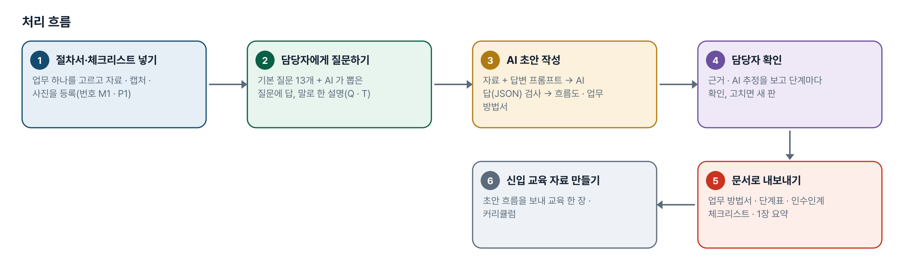
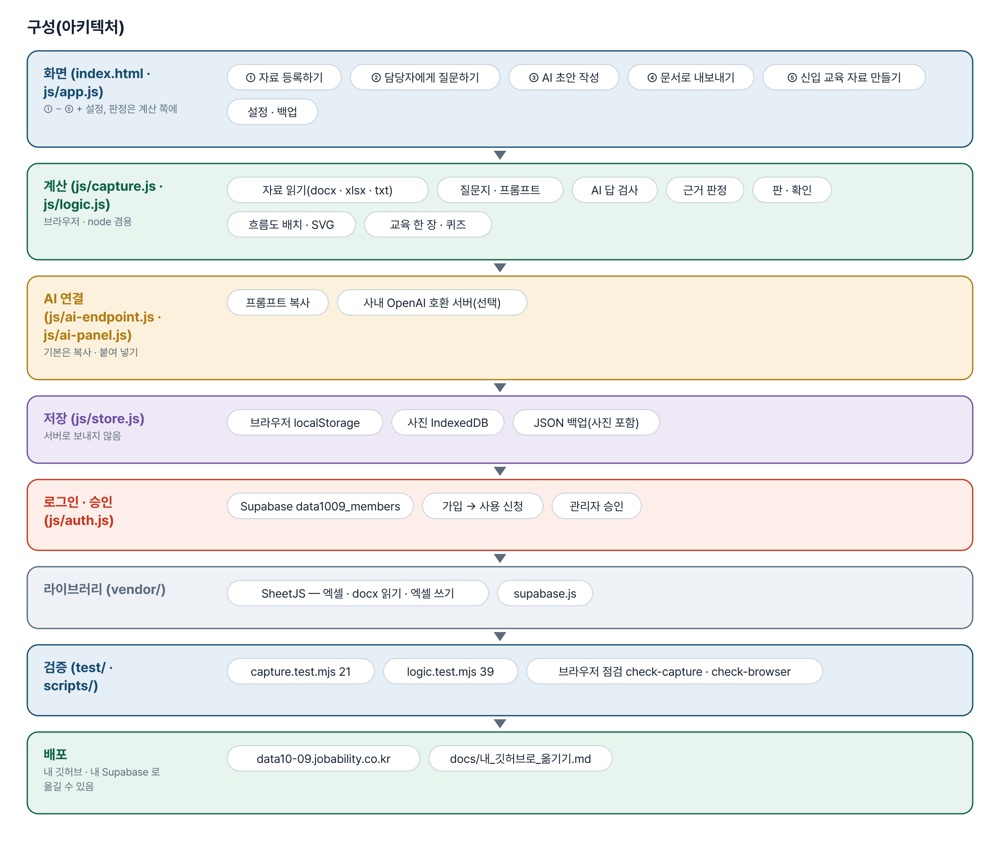
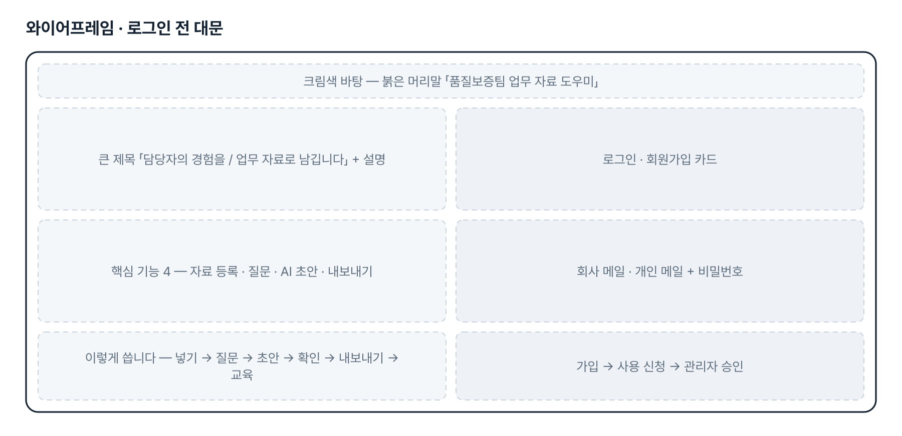
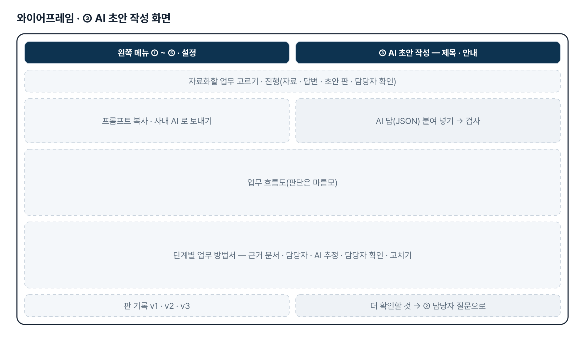
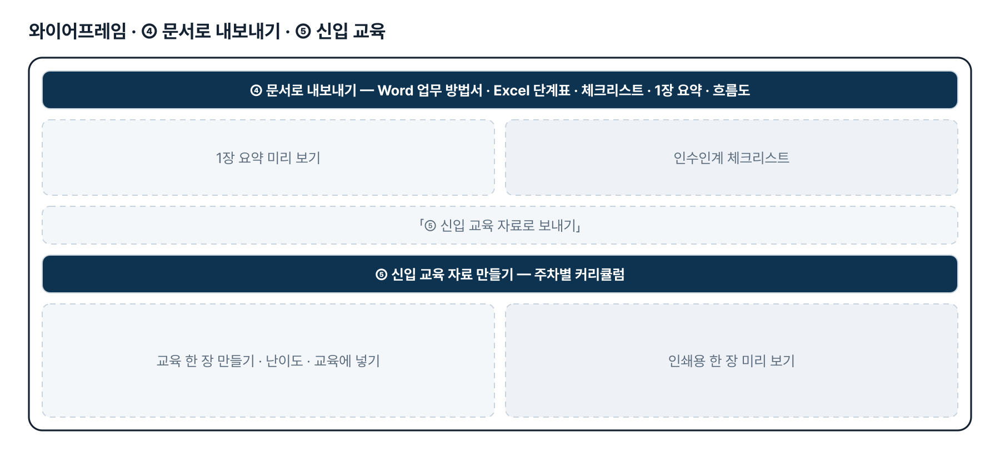
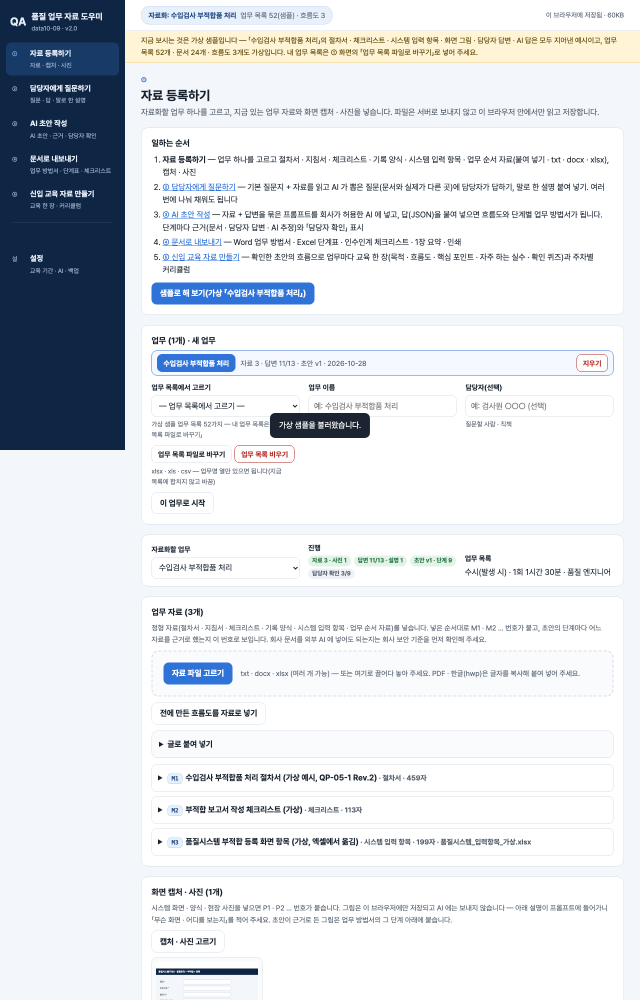

# 품질 업무 자료 도우미 — 프로젝트 기획서 v2.0

- 기획: 신나희 · 작성일 2026-11-10 · 현장 데이터 디지털화 전문가과정 · 2차수 프로젝트 09
- 바로 쓰기: https://data10-09.jobability.co.kr/
- 워드 판: `docs/기획서/data10-09_신나희_품질업무자료도우미_기획서_v2.0.docx`

## 개요

절차서 · 체크리스트 같은 업무 자료와 담당자의 설명 · 경험을 모아 업무 흐름도와 단계별 업무 방법서 초안을 만들고, 근거가 있는 부분과 확인이 필요한 부분을 나눠 보여 주는 도구입니다.

### 배경 · 현재 업무
- 품질보증팀의 업무 정보와 담당자의 경험 · 판단 기준이 여러 문서와 구두 설명에 흩어져 있습니다.
- 절차서 · 지침서에는 「무엇을 한다」가 있지만 실제 순서 · 판단 기준 수치 · 예외 · 자주 하는 실수 · 시스템 화면은 담당자의 머릿속과 말에 있습니다.
- 그래서 신규 담당자 · 업무 대체자가 업무 흐름과 수행 방법을 일관되게 익히기 어렵고 인수인계 때마다 같은 설명을 되풀이합니다.
- 처음 계획(52가지 업무 정리 · 문서 맵 · 흐름도 · 신입 교육, 10-20)에서 10-27 에 「담당자 경험을 교육 · 인수인계용 디지털 자료로 전환」으로 방향을 바꿨습니다.

### 목표
- 업무 하나를 골라 자료 → 담당자 질문 → AI 초안 → 담당자 확인 → 문서까지 한 바퀴를 돌립니다.
- 초안의 단계마다 근거(문서 · 담당자 답변 · AI 추정)를 보이고 담당자가 확인한 단계에 표시합니다.
- 결과를 Word 업무 방법서 · Excel 단계표 · 인수인계 체크리스트 · 1장 요약으로 냅니다.
- 확인한 초안의 흐름으로 신입 교육 한 장과 주차별 커리큘럼을 만듭니다.

## 요구사항과 구현

| 기획서 요구 | 구현 |
|---|---|
| 기존 업무자료 · 양식 · 업무 순서 자료를 AI 도구에 입력 | 붙여 넣기 · txt(UTF-8/EUC-KR) · docx(문단 · 표) · xlsx(시트마다), 화면 캡처 · 사진. PDF · 한글은 글자를 복사해 붙여 넣기 |
| 담당자 설명 · 경험(암묵지) 반영 | 기본 질문지 13개 + 자료를 읽고 AI 가 뽑은 질문, 질문마다 답 저장(여러 번에 나눠), 말로 한 설명 붙여 넣기, 질문지 인쇄 |
| 업무 프로세스 · 업무 방법 자료 초안 | 자료 + 답변을 묶은 프롬프트 → 회사가 허용한 AI → 답(JSON) 검사 → 흐름도 + 단계별 업무 방법서(반자동) |
| 믿을 수 있는 부분과 확인이 필요한 부분 구분 | 단계마다 근거 문서 · 담당자 · 둘 다 · AI 추정, 칸 단위 「AI 추정」, 담당자 확인 표시, 판(버전) 기록 |
| 숙지 · 공유 · 인수인계 활용 | Word 업무 방법서 · Excel 단계표(5시트) · 인수인계 체크리스트 · 1장 요약 · 흐름도 SVG/PNG |
| 신입사원 교육 자료(처음 제출) | ⑤ 신입 교육 자료 만들기 — 보낸 초안 흐름으로 교육 한 장(목적 · 흐름도 · 핵심 포인트 · 자주 하는 실수 · 퀴즈 3) · 주차별 커리큘럼 |
| 11-10 메뉴 정리 — 1단계 4개 삭제 · 6개 이름 변경 | 메뉴를 ①~⑤ + 설정으로 정리, 화면 제목 · 안내문 · 단추 문구까지 새 이름으로(저장된 자료는 그대로) |
| 11-10 대문 디자인 시안 | 로그인 전 대문을 크림색 바탕 · 남색 제목 · 붉은 머리말로, 문구는 시안 그대로. 오른쪽 예시 카드(원소재 AUDIT)는 2단계 |
| 실제 시범 업무 1개로 한 바퀴 | 2단계 — 실제 업무 · 자료 견본 · 담당자 답변을 받으면 진행(지금은 가상 샘플) |

## 주요 기능

- **자료 등록하기** — 절차서 · 체크리스트 · 양식을 붙여 넣거나 txt · docx · xlsx 로 넣고 화면 캡처 · 사진도 함께 둡니다.
- **담당자에게 질문하기** — 기본 질문 13개와 AI 가 자료를 읽고 뽑은 질문에 답을 받습니다. 여러 번에 나눠 채워도 됩니다.
- **AI 초안 작성** — 자료와 답변으로 흐름도와 단계별 업무 방법서 초안을 만들고 단계마다 근거와 AI 추정을 표시합니다.
- **문서로 내보내기** — Word 업무 방법서 · Excel 단계표 · 인수인계 체크리스트 · 1장 요약으로 받습니다.
- **담당자 확인 · 판 기록** — 단계마다 담당자가 확인하고 고치면 새 판으로 남깁니다. 바뀌지 않은 단계는 확인을 이어받습니다.
- **신입 교육 자료 만들기** — ④ 에서 보낸 초안 흐름으로 교육 한 장(목적 · 흐름도 · 핵심 포인트 · 자주 하는 실수 · 퀴즈 3)과 주차별 커리큘럼을 만듭니다.
- **로그인 · 승인** — 회사 메일 또는 개인 메일로 가입하고 사용 신청 → 관리자 승인 뒤에 씁니다.

## 처리 흐름(파이프라인)



1. **절차서·체크리스트 넣기** — 업무 하나를 고르고 자료 · 캡처 · 사진을 등록(번호 M1 · P1)
2. **담당자에게 질문하기** — 기본 질문 13개 + AI 가 뽑은 질문에 답, 말로 한 설명(Q · T)
3. **AI 초안 작성** — 자료 + 답변 프롬프트 → AI 답(JSON) 검사 → 흐름도 · 업무 방법서
4. **담당자 확인** — 근거 · AI 추정을 보고 단계마다 확인, 고치면 새 판
5. **문서로 내보내기** — 업무 방법서 · 단계표 · 인수인계 체크리스트 · 1장 요약
6. **신입 교육 자료 만들기** — 초안 흐름을 보내 교육 한 장 · 커리큘럼

## 구성(아키텍처)



- **화면 (index.html · js/app.js)** — ① 자료 등록하기 · ② 담당자에게 질문하기 · ③ AI 초안 작성 · ④ 문서로 내보내기 · ⑤ 신입 교육 자료 만들기 · 설정 · 백업
- **계산 (js/capture.js · js/logic.js)** — 자료 읽기(docx · xlsx · txt) · 질문지 · 프롬프트 · AI 답 검사 · 근거 판정 · 판 · 확인 · 흐름도 배치 · SVG · 교육 한 장 · 퀴즈
- **AI 연결 (js/ai-endpoint.js · js/ai-panel.js)** — 프롬프트 복사 · 사내 OpenAI 호환 서버(선택)
- **저장 (js/store.js)** — 브라우저 localStorage · 사진 IndexedDB · JSON 백업(사진 포함)
- **로그인 · 승인 (js/auth.js)** — Supabase data1009_members · 가입 → 사용 신청 · 관리자 승인
- **라이브러리 (vendor/)** — SheetJS — 엑셀 · docx 읽기 · 엑셀 쓰기 · supabase.js
- **검증 (test/ · scripts/)** — capture.test.mjs 21 · logic.test.mjs 39 · 브라우저 점검 check-capture · check-browser
- **배포** — data10-09.jobability.co.kr · docs/내_깃허브로_옮기기.md

## 화면 구성(와이어프레임)









## 규칙 · 판정 기준

- 근거는 도구가 판정합니다 — AI 답의 refs 가운데 실제 있는 번호(M · P = 문서, Q · T = 담당자)만 인정하고 하나도 없으면 「AI 추정」입니다.
- 없는 근거 번호 · ``` 묶음 · 끝 쉼표 · 끊긴 답 · 흐름의 고리를 검사하고 고치거나 알립니다. 끊긴 답은 저장하지 않습니다.
- 답을 못 받은 질문은 프롬프트에 「지어내지 말고 더 확인할 것으로」 넣고, 초안의 「더 확인할 것」은 다시 담당자 질문이 됩니다.
- 판마다 남기고 단계명 · 방법 · 기준 · 담당이 같은 단계만 담당자 확인을 이어받습니다. 사람이 고친 칸은 「AI 추정」 표시를 지웁니다.
- 사진은 IndexedDB 에 두고 AI 에는 그림 대신 사람이 적은 설명만 넣습니다.
- 신입 교육 한 장의 초안은 흐름도의 사실(판단 갈림 · 산출 문서 · 담당)만으로 만들고 「자주 하는 실수」는 비워 둡니다.

## 검증

- 계산 규칙 테스트 60개 통과
- node test/capture.test.mjs 21개(업무 자료화) + node test/logic.test.mjs 39개(업무 목록 · 흐름도 · 신입 교육) — 2026-11-10 모두 통과.
- 브라우저 점검(선택, playwright-core): scripts/check-capture.mjs — 메뉴 새 이름 ①~⑤ · 1단계 4개 없음 · 샘플 한 바퀴 · 내보내기 6가지 · ⑤ 로 보내기 · 4가지 폭 × 6화면 가로 넘침 0 · JS 오류 0.
- ⑤ 화면을 폭 점검에 넣자 업무 목록이 빈 상태에서 JS 오류가 나는 것을 잡아 고쳤습니다(고치기 전으로 되돌리면 같은 점검이 실패).

## 이번 판에서 하지 않는 것

- 업무 자료는 아직 팀 공유 DB 가 아니라 이 브라우저에 저장됩니다(팀원과는 JSON 백업 파일로 주고받음).
- AI 는 반자동입니다 — 프롬프트를 회사가 허용한 AI 에 사람이 넣습니다. 사내 OpenAI 호환 서버를 설정한 경우에만 자동 보내기.
- PDF · 한글(hwp) 파일은 읽지 않습니다 — 글자를 복사해 붙여 넣습니다.
- 실제 업무 자료 · 담당자 답변은 아직 받지 않아 샘플은 가상 「수입검사 부적합품 처리」입니다.
- 대문 시안의 오른쪽 예시 카드(원소재 AUDIT 단계 카드)는 이번 판의 공통 대문 틀에 없어 넣지 않았습니다.
- 메뉴에서 뺀 1단계 화면(업무 목록 가져오기 · 핵심 업무 선정 · 문서 맵 · 업무 흐름도)은 주소로만 열리고 더 손보지 않습니다.

## 다음 단계

- 실제 시범 업무 1개(예: 원소재 AUDIT)의 자료 · 담당자 답변으로 한 바퀴 → 질문지 · 출력 양식 맞추기
- 팀 공유 저장(여러 담당자가 같은 업무를 채우고 확인)
- 대문에 시안의 예시 업무 카드 넣기
- 지금 쓰는 업무 방법서 · 인수인계 양식에 맞춘 Word 출력
- 신입 교육 퀴즈 결과 · 학습 기록

## 버전 이력

- **v2.0** (2026-11-10) — 최종 기획서 — 파이프라인 · 아키텍처 · 와이어프레임 정리 / 로그인 · 사용 신청 · 관리자 승인(요청자 Supabase 로 옮길 수 있게) / 로그인 전 대문 — 시안대로 크림색 · 남색 · 붉은 머리말과 문구 / 메뉴 정리 — 「기존 도구」 4개 삭제, 6개 이름 변경(품질 업무 자료 도우미 · 자료 등록하기 · 담당자에게 질문하기 · AI 초안 작성 · 문서로 내보내기 · 신입 교육 자료 만들기) / 신입 교육을 흐름 뒤 ⑤ 로 — ④ 에서 「⑤ 신입 교육 자료로 보내기」, ⑤ 에서 난이도 · 교육에 넣기
- **v1.2** (2026-10-28) — 업무 목록 바꾸기 · 비우기(내 업무 파일로 52개 샘플 교체, 업무명 한 열만 있어도 읽음)
- **v1.1** (2026-10-28) — 방향 수정 반영 — 업무 · 자료 넣기 → 담당자 인터뷰 → AI 초안 → 내보내기, 근거 · AI 추정 · 담당자 확인 · 판 기록 / 1단계 화면은 「기존 도구」 메뉴로
- **v1.0** (2026-10-20) — 1단계 — 업무 목록 가져오기 · 핵심 업무 선정 · 문서 맵 · 업무 흐름도 · 신입 교육
